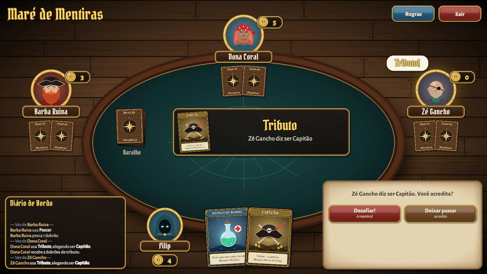
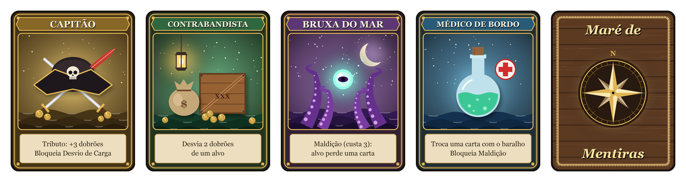
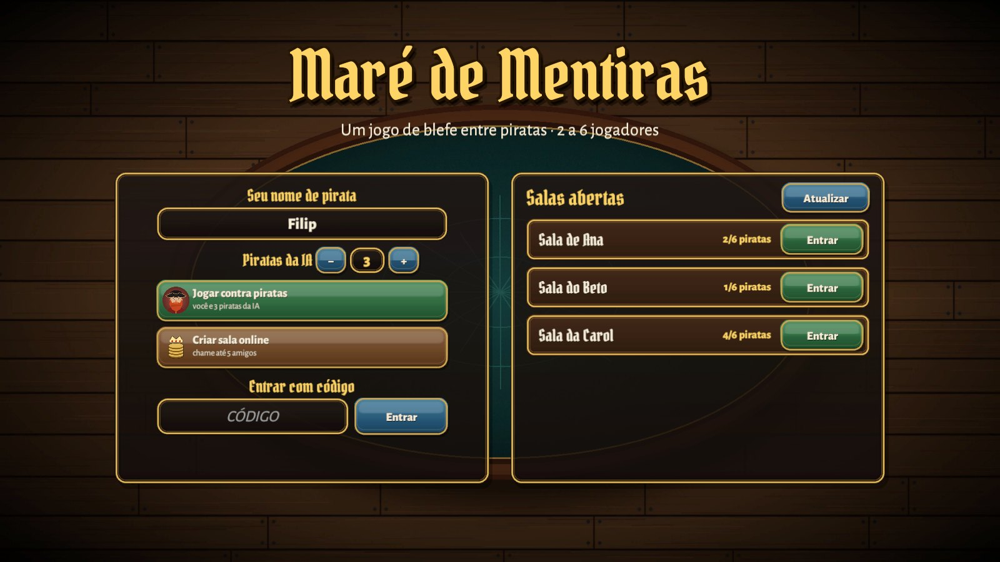
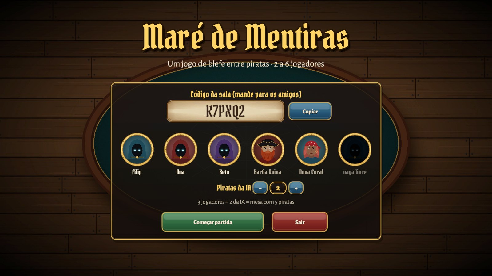
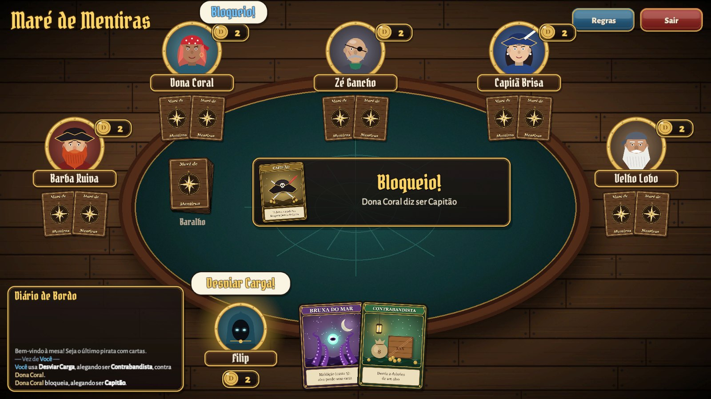
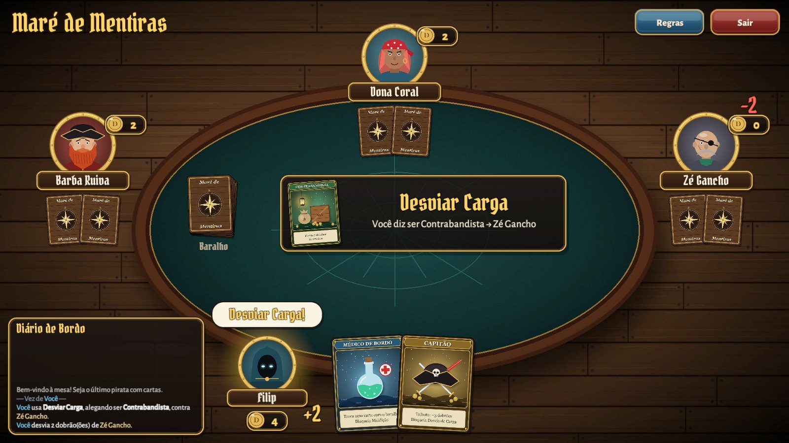
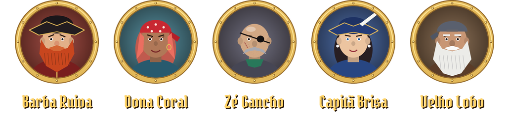

<div align="center">

# 🏴‍☠️ Maré de Mentiras

**A pirate bluffing card game for 2 to 6 players. Lie, call the bluff, keep the treasure.**

[](https://github.com/FilipFelipe/mare-de-mentiras/actions/workflows/ci.yml)


### [▶ Play in your browser](https://filipfelipe.github.io/mare-de-mentiras/) · [⬇ Download](https://github.com/FilipFelipe/mare-de-mentiras/releases/latest)



</div>

---

## The game

Every pirate starts with **2 hidden crew cards** and **2 doubloons** (*dobrões*). On your turn you take an action, and many actions require you to **claim** a character. You don't need to actually have that card. Anyone can **challenge** a claim: if it was a bluff, the liar loses a card; if it was true, the challenger does. Lose both cards and you walk the plank. **The last pirate standing wins.**

The game itself is in Portuguese 🇧🇷.

<div align="center">

</div>

### Characters

| Card | Action | Blocks |
|---|---|---|
| **Capitão** (Captain) | *Tributo*: take 3 doubloons | *Desviar Carga* |
| **Contrabandista** (Smuggler) | *Desviar Carga*: steal 2 doubloons from a pirate | — |
| **Bruxa do Mar** (Sea Witch) | *Maldição*: pay 3, target loses a card | — |
| **Médico de Bordo** (Ship's Doctor) | *Recrutar*: swap a card with the deck | *Maldição* |

### Actions anyone can take

| Action | Effect |
|---|---|
| *Pescar* (Fish) | Take 1 doubloon. Can't be challenged or blocked. |
| *Motim* (Mutiny) | Pay 7, target loses a card. Can't be blocked. **Mandatory** with 10+ doubloons. |

Tables with 5 or 6 pirates use a bigger deck (4 copies of each character instead of 3).

## Features

- 🎭 **Solo mode**: play against 1 to 5 AI pirates. They bluff, block and count the cards on the table before challenging you.
- 🌐 **Online with friends**: create a room, share the 6-letter code or pick a room from the **open rooms list**. Empty seats are filled by AI pirates.
- 🔐 **Public, private or password rooms**: private rooms stay out of the list (code only); password rooms show a 🔒 and ask for the password.
- 🔒 **No peeking**: the host runs the match and each player only ever receives their own cards.
- 🔌 **Drop-in safe**: if someone disconnects, an AI pirate takes over their seat.
- 🖥️ **Cross-platform**: web, Windows, macOS and Android can all play in the same room.
- ✨ Animated table: speech bubbles, flying coins, card flips and a ship's log of every move.

<table>
  <tr>
    <td width="50%"></td>
    <td width="50%"></td>
  </tr>
  <tr>
    <td align="center"><b>Main menu</b>: solo game, create a room or join one</td>
    <td align="center"><b>Lobby</b>: share the code, choose how many AI pirates join</td>
  </tr>
  <tr>
    <td width="50%"></td>
    <td width="50%"></td>
  </tr>
  <tr>
    <td align="center"><b>Full table</b>: 6 pirates</td>
    <td align="center"><b>Desviar Carga</b>: doubloons changing hands</td>
  </tr>
</table>

### Meet the crew

<div align="center">

</div>

## Play

| Platform | How |
|---|---|
| 🌐 **Browser** | [filipfelipe.github.io/mare-de-mentiras](https://filipfelipe.github.io/mare-de-mentiras/) |
| 🪟 **Windows** | Download `MareDeMentiras-Windows.zip` from [Releases](https://github.com/FilipFelipe/mare-de-mentiras/releases/latest), unzip, run `MareDeMentiras.exe` |
| 🍎 **macOS** | Download `MareDeMentiras-Mac.zip`, unzip, then **right-click → Open** the first time (the app isn't signed) |
| 🤖 **Android** | Download `MareDeMentiras-Android.apk` and install it (allow installs from unknown sources) |

## Building from source

**Requirements:** [Unity 6000.6.8f1](https://unity.com/releases/editor/archive) with the modules for the platforms you want (WebGL, Windows, Android…).

1. Clone the repo and open the folder in **Unity Hub → Add → Add project from disk**.
2. Open `Assets/Scenes/Jogo.unity` and press **Play**. The game builds its whole UI from code, so there's nothing to set up in the scene.

### Online play (optional)

Online rooms use **Unity Gaming Services** (Sessions + Relay). It's free for small groups, and you don't need your own server.

1. In Unity: **Edit → Project Settings → Services** and link the project to your Unity Cloud organization.
2. If creating a room fails, enable **Relay** for the project at [cloud.unity.com](https://cloud.unity.com).

Without a linked project, solo mode works normally and the menu explains how to enable online play.

## Project structure

```
Assets/MareDeMentiras/
├── Scripts/
│   ├── Rules.cs        # rules, costs, character data
│   ├── Table.cs        # match engine: turns, challenges, blocks, AI (runs on the host)
│   ├── Protocol.cs     # events sent to each player (only their own cards)
│   ├── NetSession.cs   # rooms, room codes and messaging (Unity Gaming Services + Netcode)
│   ├── GameManager.cs  # app flow: menu, lobby, solo/host/client
│   ├── GameUI.cs       # the table, seen from each player's seat
│   ├── MenuUI.cs       # main menu, open rooms, lobby
│   └── UIKit.cs        # shared UI pieces and animations
├── Editor/             # project settings guard (app id, WebGL template…)
├── Tests/              # EditMode + PlayMode tests
└── Resources/          # card art, UI art, fonts
Assets/WebGLTemplates/  # browser page with the pirate loading screen
```

## Tests and CI

```
Window → General → Test Runner → Run All
```

- **EditMode:** rules consistency, deck size for every table size, network message round-trips, nickname sanitizing.
- **PlayMode:** whole simulated matches with 2 to 6 players, with humans answering at random, invalid answers, and players leaving mid-game. After **every move** they check that no player ever receives another player's hidden cards.

[GitHub Actions](.github/workflows/ci.yml) (via [GameCI](https://game.ci)) runs the tests on every push and pull request. On `main` it also builds **Windows, macOS and Android**, and deploys the **web version to GitHub Pages**. Pushing a tag like `v1.0.0` publishes a **Release** with all builds.

The workflow needs these repository secrets: `UNITY_LICENSE`, `UNITY_EMAIL` and `UNITY_PASSWORD` ([how to get them](https://game.ci/docs/github/activation)). GitHub Pages must be set to **Source: GitHub Actions**.

## Credits

- Art: every card, portrait, icon and UI piece is drawn procedurally by code. There are no external art assets.
- Fonts: [Pirata One](https://fonts.google.com/specimen/Pirata+One) and [Alegreya Sans](https://fonts.google.com/specimen/Alegreya+Sans), both under the [SIL Open Font License](Assets/MareDeMentiras/Resources/Fonts/).
- Built with [Unity](https://unity.com), [Netcode for GameObjects](https://docs-multiplayer.unity3d.com/) and [Unity Gaming Services](https://unity.com/solutions/gaming-services).
